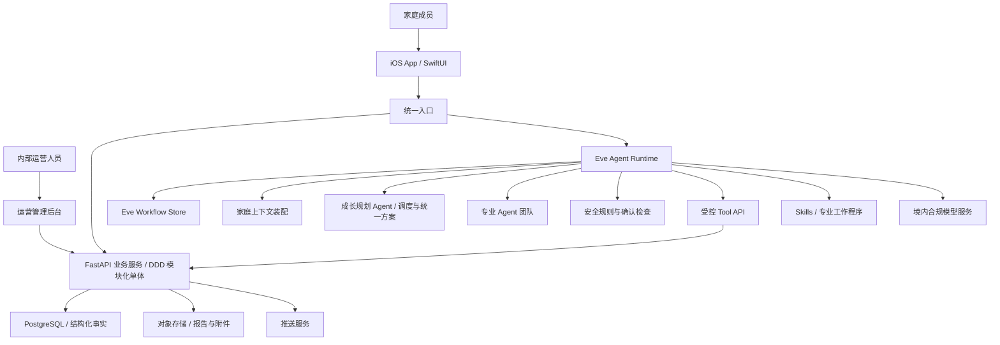
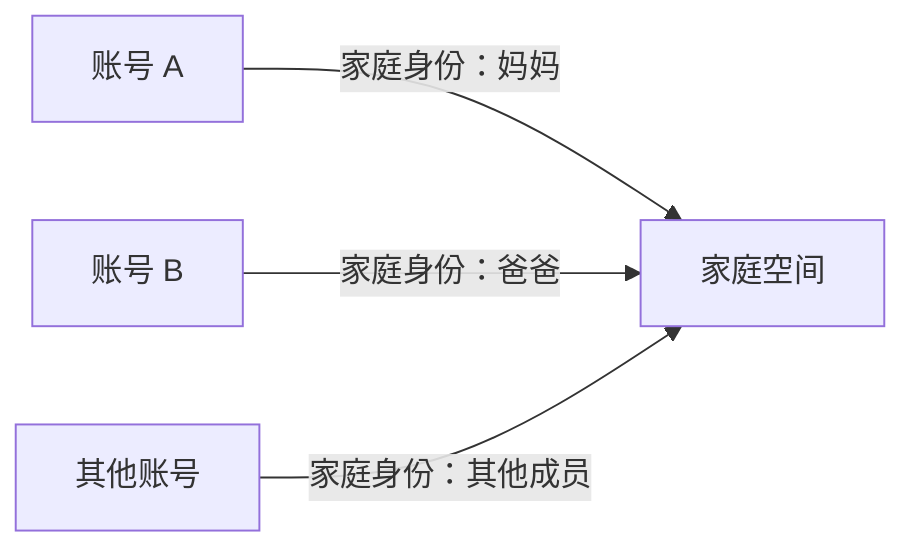

# 孕期 AI Agent App 整体架构方案

## 1. 文档定位

本文档定义首期孕期 AI Agent App 的整体系统边界、核心组成、数据与 Agent 运行方式，以及首版必须保留的安全底线。

本架构服务于已经确认的产品总方案和完整用户旅程。它不是实施计划，也不展开每个功能页面或每个 Agent 的详细 Skills。

本文描述完整孕期产品的系统边界。当前 MVP 的具体技术实现、DDD 分层和目录规范以《孕期 AI Agent App MVP 技术架构》为准；原有任务队列、Agent Worker 和流式协议描述已由最新 ADR 更新。

## 2. 首期范围与约束

### 2.1 产品范围

- 首期只做孕期；
- 从确认怀孕覆盖到分娩住院、出院及产后最初几天的自然交接；
- 首发客户端为 iOS；
- 优先服务实际生活在浙江杭州的家庭；
- 按真实用户和真实健康资料使用场景设计，而非内部演示；
- 首期不接 HealthKit；
- 首期不建设社区、在线医生、Skill 生态或跨城市平台。

### 2.2 核心架构原则

1. 家庭是协作空间，账号是独立主体，妈妈、爸爸等是账号在家庭中的身份；
2. App 功能既供用户直接使用，也是 Agent 可以调用的 Tools；
3. 业务事实是唯一真相，Agent 对话与记忆不能替代正式档案和计划；
4. 多个专业 Agent 共用一套 Runtime、Tools、数据与审计机制；
5. 普通功能不能依赖模型可用性，Agent 失败时待办、记录和计划仍可正常使用；
6. 首版保持架构清晰，但不提前建设复杂微服务、权限平台或合规中台。

## 3. 高层系统架构

系统由四个主要运行面组成：

- iOS App：用户体验、关键缓存、离线记录和 Agent 任务展示；
- 业务服务端：家庭、孕期、计划、记录、权限和同步的事实中心；
- Eve Agent Runtime：持久化会话、专业协作、Skills、流式事件、安全检查和 Tool 调用；
- 运营管理后台：维护任务、知识、杭州资料和处理失败任务。

## 4. iOS 客户端架构

首期使用 SwiftUI 原生开发。iOS 端采用“本地优先体验、云端为事实中心”的方式。

### 4.1 App Shell

承载账号、家庭切换、五个一级入口、全局 Agent 入口，以及日常模式和分娩模式的切换。

五个一级入口为：

- 今天；
- 计划；
- 记录；
- Agent 团队；
- 家庭。

### 4.2 功能模块

各功能模块共享导航、设计系统、网络与本地存储能力，但保持业务边界清楚。首期包括阶段计划、待办、日历、报告、日常记录、家庭协作、杭州事项和分娩模式等。

### 4.3 本地数据与同步

iOS 缓存当前阶段、近期计划、待办、必要档案摘要和待产应急信息。服务端是家庭共享数据的最终事实来源，但本地未同步操作不能被简单覆盖。

### 4.4 离线边界

无网或弱网时至少支持：

- 查看已缓存的今日计划和待办；
- 查看待产应急卡片、医院信息和联系人；
- 记录宫缩、胎动和普通事项；
- 完成或新增待办；
- 网络恢复后自动同步。

Agent、多成员实时同步和报告识别需要网络。分娩应急信息必须提前缓存，不能临产时才下载。

### 4.5 首期明确不做

- HealthKit；
- Android 或跨平台客户端；
- 依赖 iOS 常驻后台的 Agent 工作；
- 把聊天页作为唯一产品入口。

## 5. 账号与家庭架构

### 5.1 核心模型

账号和家庭空间分离：

- 每个成员使用独立账号；
- 任一成员可以创建家庭并邀请对方；
- 妈妈、爸爸等是家庭成员身份，不是写死的账号类型；
- 家庭共同保存计划、待办、日历、用品和协作记录；
- 个人账号保留个人设置、私密对话和私密记录；
- 孕妇健康信息默认由本人控制，可主动共享给家庭成员。

首期重点支持妈妈和爸爸互相邀请并形成一个家庭，但底层允许未来增加其他家庭成员身份。

### 5.2 首期权限边界

首期不建设复杂字段级权限平台，只提供：

- 家庭数据隔离；
- 家庭成员身份；
- 家庭共同数据与个人数据区分；
- 孕妇健康资料的本人可见和主动共享；
- 家庭加入、退出与邀请管理。

## 6. 业务服务端架构

业务侧采用轻量 DDD 模块化单体，Agent 侧采用独立 Eve Runtime 服务。

### 6.1 模块化单体

业务服务内部按领域划分：

- 账号与家庭；
- 孕期档案；
- 阶段与计划；
- 待办与日历；
- 健康报告与记录；
- 家庭协作；
- 杭州事务与服务；
- 通知；
- 权限与操作记录；
- Agent 与 Tool 接口。

这些模块共享一次部署和主数据库，但代码边界、领域对象和接口保持清楚。

### 6.2 Eve Agent Runtime

Eve 作为独立 TypeScript/Node.js 服务，处理 Agent 会话、模型调用、成长规划 Agent、专业 Subagents、Skills、流式事件、人工确认，以及确有需要时的 Schedules。

Eve 不直接访问 PostgreSQL。所有业务查询和修改通过 FastAPI 的受控 Tool API 完成。业务事实保存在 PostgreSQL，Eve Workflow Store 只保存 Agent 会话和执行状态。

当前 MVP 不在 FastAPI 与 Eve 之间增加 Celery、Redis 或消息队列；后续只有出现无法由 Eve Runtime 和现有服务承担的可靠后台任务时再单独评估。

### 6.3 首期明确不做

- 微服务拆分；
- 每个专业 Agent 独立部署；
- 每个领域独立数据库；
- 重型消息平台；
- 全量事件溯源；
- 多区域部署。

## 7. Agent 运行架构

所有专业 Agent 运行于统一 Eve Agent Runtime。

### 7.1 标准执行链

### 7.2 Runtime 职责

- 接收用户、数据、时间和外部资料变化触发；
- 只装配本次任务必要的上下文；
- 确定主责 Agent 和协作 Agent；
- 管理冲突与统一结果；
- 检查安全规则、权限与确认状态；
- 通过 Tool Gateway 执行业务操作；
- 保存任务状态、结果与后续跟进。

### 7.3 专业 Agent

首期专业角色包括成长规划、孕产、妈妈照护、健康就医、营养、家庭协作和杭州生活事务 Agent。

不同 Agent 拥有不同职责、Skills 和工作上下文，但共用：

- 家庭事实；
- 知识与规则；
- Tools；
- 权限检查；
- 任务状态；
- 操作记录。

Agent 不直接访问数据库，也不能绕过主责关系各自修改计划。

### 7.4 Tool Gateway

Tool Gateway 是 Agent 与业务功能之间的唯一执行通道。每个 Tool 明确：

- 所需输入；
- 可读取的事实；
- 可产生的修改；
- 是否需要用户确认；
- 幂等和重试方式；
- 成功、失败和撤销结果。

## 8. 主动任务与通知架构

### 8.1 服务端主动运行

Agent 主动工作由服务端执行，不依赖 iOS 常驻后台。主要触发包括：

- 孕周或阶段变化；
- 产检、复查和政策时限临近；
- 报告或记录新增；
- 待办延期；
- 家庭成员修改任务；
- 杭州资料更新；
- Agent 预先设置的跟进时间。

### 8.2 任务状态

Agent 主动任务使用以下状态：

> 待运行 → 运行中 → 等待确认 → 已执行 → 已完成 / 失败 / 已取消

同一事件不能重复创建多套计划；失败任务可安全重试；同一家庭的重要修改按顺序处理。

### 8.3 通知分级

- 风险事项；
- 需要用户决定；
- 重要计划；
- 普通动态和每日摘要。

锁屏通知不直接暴露详细健康信息。普通动态应合并，避免把 Agent 主动工作变成大量打扰。

## 9. 核心数据架构

### 9.1 事实分类

1. 账号、家庭、成员身份和邀请关系；
2. 孕妇主体、孕期、医院和孕期档案；
3. 医疗报告原文件、机器提取、用户确认和医生信息；
4. 症状、体重、饮食、睡眠、情绪、胎动和宫缩等记录；
5. 阶段、目标、计划、待办、日历、提醒和家庭分工；
6. 阶段知识、安全规则、杭州政策与服务资料；
7. Agent 触发、主责、协作、Tool 调用和结果记录。

### 9.2 事实优先级

> 医生确认信息 > 用户确认信息 > 报告机器提取 > Agent 推导 > 普通知识建议

Agent 推导不能覆盖医生结论或用户确认事实。发生冲突时生成待核实项。

### 9.3 存储选择

- PostgreSQL：账号、家庭、档案、记录、计划、权限和 Agent 元数据；
- 对象存储：报告、图片和附件；
- Eve Workflow Store：Agent 会话、流式游标和执行状态；
- Redis：当前 MVP 不使用；后续如确有独立缓存或限流需求再评估。

首期不引入专用图数据库、时序数据库或独立向量数据库。

## 10. 知识与规则架构

产品内容分为四类：

1. 阶段任务库：计划底稿、适用条件、建议时间、依赖与完成标准；
2. 专业知识库：孕期健康、营养、运动、情绪与待产知识；
3. 安全规则库：风险信号、禁止行为、确认规则和医疗升级条件；
4. 杭州资料库：政策、机构、材料、补贴、服务与有效期。

每条正式内容记录来源、版本、适用范围和更新时间。发布流程为：

> 资料录入 → 来源核验 → 专业审核 → 版本发布 → Agent 可用

Agent Skill 规定专家何时介入、读取哪些事实、使用哪些知识、如何判断、调用哪些 Tools、输出什么以及何时升级。

首期不建设通用 Skill 平台，但 Skills 必须结构化、可版本化、可测试，不能只存在于一个巨大的提示词中。

## 11. 模型与数据处理边界

- 用户数据默认在中国大陆部署和处理；
- 模型服务优先选择可明确约定数据用途、留存方式和不用于训练的服务；
- 跨境模型不作为默认路径；
- 原始健康报告、身份信息等敏感数据不无差别发送给模型；
- Agent 调用模型前，由服务端选择必要上下文并进行必要的数据最小化处理；
- 模型不可用时，基础功能继续工作。

## 12. 运营管理后台

首期提供简化的内部 Web 后台，主要用于：

- 维护阶段任务；
- 维护专业知识和安全规则；
- 维护杭州政策、机构与服务资料；
- 配置 Agent、Skills 和可用 Tools；
- 查看并重试失败的报告识别、Agent 与通知任务。

首期不建设复杂多级审批、完整审计中心或在线医生工作台。后台用户不能默认浏览全部家庭健康数据。

## 13. 首版安全底线

首版保留以下必要控制：

- 独立账号与家庭邀请；
- 家庭之间严格数据隔离；
- 孕妇健康信息默认本人可见，可主动共享；
- Agent 只能通过受控 Tools 操作；
- 医疗相关输出明确不能替代医生；
- 用药和就医相关事项不自动执行；
- 报告与健康资料加密传输、受限访问；
- 用户可以退出家庭和删除账号；
- Agent 重要修改可查看、可撤销。

首期暂不建设：

- 字段级权限配置；
- 临时授权自动回收；
- 多级后台审批；
- 完整数据导出平台；
- 复杂审计中心；
- 多套身份验证策略；
- 在线医生或人工医疗介入；
- 用户自定义的数据保存周期。

## 14. 可靠性与失败处理

### 14.1 基础功能优先

模型、Agent、知识检索或报告识别失败时，计划、待办、记录、家庭协作和离线应急信息仍可使用。

### 14.2 Agent 失败

- 任务保留失败状态和原因；
- 可安全重试；
- 不产生半完成修改；
- 已执行的 Tools 明确记录；
- 用户可以看到失败并继续手工处理。

### 14.3 数据冲突

多成员或离线同步冲突时，服务端不静默丢弃操作。关键健康事实冲突生成待核实项；普通待办按版本与业务规则合并。

### 14.4 外部服务失败

- 模型服务失败：降级为普通功能和已有知识内容；
- 推送失败：事项仍保留在 App 内；
- 对象存储或识别失败：保留上传状态并允许重试；
- 杭州外部信息不可用：显示最近已核验版本和更新时间。

## 15. 非功能要求

首期不承诺大规模平台指标，但按正式产品保留以下目标：

- 关键数据写入具有事务一致性；
- 普通业务 API 与 Agent 调用解耦；
- 关键分娩信息可离线读取；
- 服务端和模型调用具备基本日志、指标和错误告警；
- 核心数据库和对象存储具备备份；
- 敏感内容不进入普通日志和锁屏通知；
- 架构允许后续增加 Android、产后阶段和更多地区，但不为这些未来能力提前实现复杂平台。

## 16. 关键架构决策摘要

| 决策 | 已选方案 | 暂不采用 |
|---|---|---|
| 首发客户端 | 原生 iOS / SwiftUI | 跨平台、Android 同期 |
| 家庭模型 | 独立账号 + 家庭空间 + 家庭身份 | 共享账号、妈妈主账号附属伴侣 |
| 服务端 | FastAPI 轻量 DDD 模块化单体 + 独立 Eve Runtime | 领域微服务体系 |
| Agent | Eve 根 Agent + 专业 Subagents + 受控 Tool API | 自建 Runtime、每个 Agent 独立系统 |
| 数据真相 | 结构化业务事实 | 以对话记忆为事实 |
| 核心存储 | PostgreSQL + 对象存储 + Eve Workflow Store | 多种专用业务数据库 |
| 主动运行 | Eve Schedules 按需启用 + 分级通知 | 依赖 iOS 后台常驻 |
| 健康接入 | App 内记录和报告 | HealthKit |
| 模型数据边界 | 中国大陆默认处理，明确不用于训练 | 默认跨境处理 |
| 安全范围 | 首版必要底线 | 复杂权限与合规中台 |

## 17. 后续工作顺序

整体架构确认后，当前 MVP 按以下顺序推进：

1. 建立 Monorepo 与契约目录；
2. 完成 Eve 自托管、模型、流式和 Tool 技术验证；
3. 初始化 FastAPI DDD 业务骨架；
4. 实现家庭、孕期、计划和待办核心闭环；
5. 实现成长规划 Agent、孕产专家、Skills 与 Evals；
6. 实现 iOS Onboarding、Today、Plan、Agent 和 Family；
7. 完成端到端验收、部署和 TestFlight 验证。

详细实施边界见《孕期 AI Agent App MVP 技术架构》和《Monorepo 初始目录规范》。
