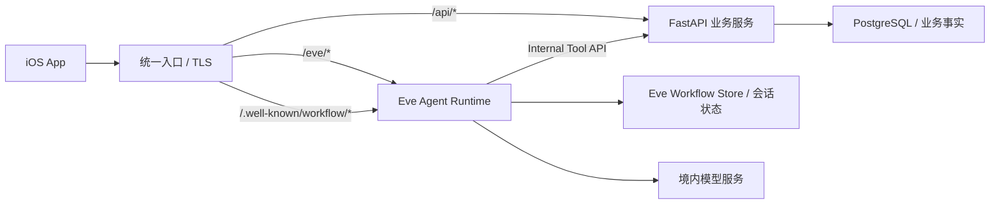

# 孕期 AI Agent App MVP 技术架构

## 1. 文档定位

本文档定义孕期 AI Agent App MVP 的可实施技术架构，包括系统拓扑、DDD 限界上下文、服务端分层、核心聚合、Eve Agent Runtime、iOS 分层、协议、事务、失败处理、测试、部署和本地开发。

本文档是 MVP 技术实施的主入口。产品长期边界仍以产品总方案和完整用户旅程为准；与旧系统架构中的任务队列、Agent Worker 或 FastAPI SSE 描述冲突时，以本文和最新 ADR 为准。

## 2. MVP 目标与边界

MVP 只验证以下行动闭环：

> 用户提供孕周和当前情况 → 系统形成今天与未来四周计划 → 用户或家庭成员完成、延期和分配任务 → Agent 根据新情况调用业务 Tools 调整同一份计划 → 后续持续追踪。

### 2.1 MVP 包含

- 原生 iOS App；
- 账号、家庭邀请和妈妈、爸爸等家庭身份；
- 孕期基础档案、预产期和动态孕周；
- Today、未来四周计划和普通待办；
- 完成、延期、编辑和家庭成员分配；
- 成长规划 Agent；
- 一个孕产专家 Subagent；
- 孕期规划和杭州高频事项 Skills；
- Agent 查询孕期上下文并创建、更新待办；
- 确定性医疗风险规则；
- 关键数据本地只读缓存和普通待办离线操作。

### 2.2 MVP 不包含

- 报告 OCR、指标趋势和完整健康记录中心；
- 七个完整专业 Agent；
- 分娩住院模式和产后交接；
- 医院、月嫂和用品服务平台；
- 运营管理后台；
- HealthKit；
- Celery、Redis、消息总线和微服务体系；
- 全天候主动 Agent 和复杂 Schedules；
- 通用 Skill 平台；
- Android 和跨区域部署。

## 3. 技术决策摘要

| 领域 | 方案 |
|---|---|
| iOS | SwiftUI、Observation、async/await、SwiftData 缓存 |
| 业务 API | Python、FastAPI、Pydantic |
| 业务架构 | 轻量 DDD 模块化单体 |
| 数据访问 | SQLAlchemy 2.0、Alembic |
| 主数据库 | PostgreSQL |
| Agent Runtime | 独立 Eve TypeScript/Node.js 服务 |
| Agent 协作 | 成长规划根 Agent + 孕产专家 Subagent |
| Agent 流 | Eve 原生可恢复 NDJSON HTTP Stream |
| API 契约 | FastAPI OpenAPI；生成 Swift 与 TypeScript Client |
| 部署 | 中国大陆单区域、自托管容器、统一入口 |
| 可观测性 | OpenTelemetry、结构化脱敏日志、统一关联标识 |

模型供应商、账号认证供应商、Eve 生产 Workflow Store 实现和具体云厂商尚未选择，需通过技术验证或后续 ADR 确定。

## 4. 高层系统拓扑



系统只有两个服务端部署单元：

1. FastAPI 业务服务：业务事实、权限、事务和 Tools；
2. Eve Agent Runtime：会话、模型调用、Skills、Subagents、流式事件和人工确认。

Eve Workflow Store 不是业务事实源。即使 Agent 会话不可用，家庭、孕期、计划和待办仍以 PostgreSQL 为准并可由普通功能操作。

## 5. DDD 上下文地图

FastAPI 采用模块化单体。限界上下文独立建模，但共享一次部署和一个 PostgreSQL 实例。

### 5.1 Identity & Access

负责账号状态、登录身份、认证上下文和设备会话。具体认证供应商属于 Adapter，不进入领域模型。

### 5.2 Family

负责家庭、成员身份、邀请、加入退出和共享边界。妈妈、爸爸是账号在家庭中的身份，不是账号类型。

### 5.3 Pregnancy Journey

负责孕期主体、预产期、孕期状态、阶段、医生要求和用户确认事实。孕周由预产期和指定日期计算，不保存为每天失效的静态事实。

### 5.4 Planning

负责孕期计划、阶段计划、任务、期限、分配、完成、延期和调整历史，是 MVP 的核心业务上下文。

### 5.5 Guidance & Safety

负责阶段任务模板、杭州事项、内容来源、适用条件、版本和确定性风险规则。安全规则不能只存在于模型提示词中。

### 5.6 Agent Access

作为 FastAPI 与 Eve 之间的防腐层，负责上下文装配、受控 Tool API、Agent Actor、身份校验、幂等和调用记录。它不实现 Agent 循环。

### 5.7 上下文协作规则

- 上下文只能引用其他上下文的 ID 或公开 Application Contract；
- 禁止导入其他上下文的 ORM Model；
- 跨上下文写流程由 Application Coordinator 编排；
- Today 等跨上下文页面由只读 Composition 层组装；
- 只读查询可以优化，但不能绕过写入规则。

## 6. FastAPI DDD 分层

项目采用“限界上下文优先、上下文内部再分层”的目录结构。

```text
services/api/src/aim_api/
├── contexts/
│   ├── identity/
│   ├── family/
│   ├── pregnancy/
│   ├── planning/
│   ├── guidance/
│   └── agent_access/
│       ├── domain/
│       ├── application/
│       └── adapters/
│           ├── inbound/http/
│           └── outbound/persistence/
├── composition/
├── kernel/
├── platform/
└── bootstrap.py
```

### 6.1 Domain

纯 Python，不依赖 FastAPI、Pydantic 或 SQLAlchemy。包含聚合根、实体、值对象、领域服务、领域策略、领域事件、业务异常和不变量。

### 6.2 Application

负责 Command、Query、Use Case、Repository Port、Unit of Work Port、权限 Port、跨上下文 Contract 和输入输出 DTO。Application 组织流程，不复制领域规则。

### 6.3 Adapters

- Inbound：FastAPI Router、Pydantic Schema、认证上下文、Public API 和 Internal Tool API；
- Outbound：SQLAlchemy Model、Repository 实现、外部服务 Client 和内容加载器。

### 6.4 Platform 与 Bootstrap

负责配置、数据库引擎、日志、OpenTelemetry、依赖装配和 FastAPI 启动，不包含领域规则。

依赖方向固定为：

```text
Adapters → Application → Domain
Bootstrap → 具体实现
Domain → 不依赖外层
```

`kernel/` 只允许放 EntityId、Clock、DomainEvent 和少量跨上下文基础错误，禁止放公共业务模型。

## 7. 核心聚合

| 上下文 | 聚合根 | 核心不变量 |
|---|---|---|
| Identity | Account | 停用账号不能执行家庭操作 |
| Family | Family | 同一账号不能以重复成员身份加入同一家庭 |
| Family | Invitation | 邀请只能在有效期内使用一次 |
| Pregnancy | Pregnancy | 生命周期和预产期变更必须保持可追溯 |
| Pregnancy | PregnancyFact | 每条事实必须有来源、确认级别和发生时间 |
| Planning | PregnancyPlan | 同一孕期只有一个当前计划版本 |
| Planning | Task | 状态转换、负责人和版本必须合法 |
| Guidance | GuidanceItem | 内容必须有来源、适用范围和版本 |
| Guidance | SafetyRule | 风险条件必须产生确定的升级动作 |
| Agent Access | ToolInvocation | 同一 Actor 与幂等键只能产生一个业务结果 |

`PregnancyPlan` 与 `Task` 是不同聚合，允许家庭成员并发操作不同任务。Task 必须保存来源：模板、用户、Agent、医生要求或家庭成员。

Agent 不是业务聚合，只是 Actor 类型之一：

```text
Actor = Account | Agent
```

事实冲突策略保持：

> 医生确认 > 用户确认 > 机器提取 > Agent 推导 > 普通知识。

## 8. Eve Agent Runtime

```text
services/agent/
├── package.json
├── agent/
│   ├── agent.ts
│   ├── instructions/
│   ├── channels/eve.ts
│   ├── tools/
│   ├── skills/
│   ├── subagents/pregnancy-expert/
│   ├── hooks/
│   ├── lib/
│   └── instrumentation.ts
└── evals/
```

### 8.1 成长规划 Agent

根 Agent 唯一直接面对用户。它读取必要上下文、选择是否调用孕产专家、形成一份统一方案，并通过 Tools 操作计划和待办。

### 8.2 孕产专家 Subagent

只提供专业判断，默认仅拥有只读 Tools。它不能直接创建、修改或完成任务，也不向用户输出最终答案。

### 8.3 Skills

Skill 保存专家工作程序：介入条件、读取内容、判断步骤、输出结构和升级边界。正式任务、杭州资料和安全规则由 FastAPI Guidance Context 管理，Skill 不复制业务事实。

### 8.4 Tools

MVP Tools 包括：

- `get_pregnancy_context`；
- `list_tasks`；
- `create_task`；
- `update_task`；
- `assign_task`；
- `record_pregnancy_fact`；
- `get_guidance`。

写 Tool 必须调用 FastAPI Application Use Case，不能直接访问 PostgreSQL。与孕期产品无关的 Bash、文件写入、通用 Web、Shell 和开放式代理工具默认关闭。

Schedules、更多 Subagents、Sandbox 和外部 Connections 只有在产品需求出现后才增加。

## 9. Eve 与 FastAPI 契约

### 9.1 身份

iOS 用户 Token 经 Eve Channel 验证后形成 `ctx.session.auth`。Eve Tool 从已验证 Session 获取账号和家庭上下文，不能让模型提供这些 ID。

Eve 调用 FastAPI Internal Tool API 时携带：

```text
Service-Authorization
Actor-Account-Id
Family-Id
Pregnancy-Id
Eve-Session-Id
Idempotency-Key = sessionId + callId
```

FastAPI 必须再次验证账号、家庭成员关系、孕期归属和 Tool 权限。Service Credential 不能代替业务权限检查。

### 9.2 Tool 结果

统一返回：

```json
{
  "operation_id": "...",
  "status": "completed",
  "summary": "已创建两周后复查任务",
  "data": {}
}
```

Tool 输出只包含模型完成下一步所需的最少内容，不返回密钥、完整健康资料或无边界原文。

### 9.3 错误

```json
{
  "code": "task.version_conflict",
  "message": "任务已被其他家庭成员修改",
  "trace_id": "...",
  "retryable": false,
  "details": {}
}
```

Eve 只能自动重试明确标记为可重试且幂等的操作。

## 10. Agent 会话与流式协议

iOS 直接使用 Eve 原生可恢复 NDJSON HTTP Stream，不通过 FastAPI 代理，也不转换为 SSE。

iOS 保存：

- `sessionId`；
- `continuationToken`；
- `streamIndex`。

断线后从 `streamIndex` 恢复。Eve Tool 完成后，iOS 重新查询 FastAPI 的 Today 或 Plan，不从 Agent 文本推测业务事实。

统一入口必须原样代理：

- `/eve/*`；
- `/.well-known/workflow/*`。

## 11. iOS 分层

iOS 使用 Feature-first 结构，不复制服务端 DDD。

```text
apps/ios/AimApp/
├── App/
├── Core/
│   ├── Auth/
│   ├── Networking/
│   ├── Persistence/
│   ├── DesignSystem/
│   └── Observability/
├── Clients/
│   ├── BusinessAPIClient/
│   └── EveClient/
├── Features/
│   ├── Onboarding/
│   ├── Today/
│   ├── Plan/
│   ├── Agent/
│   └── Family/
├── Generated/OpenAPI/
└── Resources/
```

每个 Feature 由 View、Store、Models、Dependencies 和 Tests 构成。使用 SwiftUI Observation 和 async/await，不引入 TCA，也不建设通用状态管理框架。

`AppSessionStore` 只保存当前账号、家庭、孕期、认证和网络状态。Feature 状态由各自 Store 管理。

### 11.1 Business API Client

FastAPI 输出 OpenAPI，通过 Swift OpenAPI Generator 生成客户端。Generated DTO 由 Repository 转换后再提供给 Feature。

### 11.2 Eve Client

手写 `actor EveClient`，负责 start、send、resume、respondToApproval 和 cancel，并把 NDJSON 映射为 `AsyncThrowingStream<EveEvent, Error>`。

事件 Schema 必须在 Eve 技术验证中固定，不能根据示例代码猜测。

### 11.3 本地存储

SwiftData 只缓存可替换的 Read Model、Eve Session Cursor 和普通待办离线操作。Token 存 Keychain。PostgreSQL 仍是业务事实源。

## 12. 事务与一致性

```text
HTTP / Agent Tool
→ Application Command
→ Aggregate
→ Unit of Work
→ PostgreSQL Commit
→ 进程内 Domain Events
```

- 每个写 Command 默认修改一个聚合；
- 聚合使用版本号进行乐观并发控制；
- 同一 Agent 幂等键只产生一个结果；
- 跨上下文流程由 Application Coordinator 编排；
- 需要用户可见原子性时，可在同一个 PostgreSQL 事务中协调多个 Repository；
- Eve 不参与数据库事务；
- 通知、跟进和非核心副作用在 Commit 后执行；
- MVP 不引入分布式事务、事件总线或完整 CQRS 基础设施。

## 13. 失败处理

| 故障 | 处理 |
|---|---|
| 模型不可用 | 普通计划、待办和家庭功能继续工作 |
| Eve 不可用 | 保留业务事实，提示 Agent 暂不可用 |
| Tool 超时 | 使用同一幂等键查询或安全重试 |
| 版本冲突 | 返回 409，iOS 刷新后让用户处理 |
| 权限失败 | 返回 403，不允许 Agent 改写请求 |
| PostgreSQL 不可用 | 拒绝写入，不生成伪成功结果 |
| 流式连接中断 | iOS 使用 streamIndex 重新连接 |
| Eve 重启 | Workflow Store 恢复会话；能力由技术验证证明 |

模型或 Agent 的自然语言不能作为操作成功凭证；FastAPI 的业务结果才是最终结果。

## 14. 测试体系

### 14.1 FastAPI

- 纯 Domain 单元测试；
- Application Use Case 与 Fake Port 测试；
- 真实 PostgreSQL Repository 和 Alembic 迁移测试；
- Public API 与 Internal Tool API 契约测试；
- 架构测试，禁止跨层和跨上下文非法依赖。

### 14.2 Eve

- Tool Zod Schema 和 FastAPI Client 测试；
- Mock Model 确定性 Eval；
- 真实候选模型场景 Eval；
- 成长规划 Agent 调用孕产专家并统一输出；
- Tool 权限、幂等、审批与错误分支；
- 断线、恢复和服务重启场景。

### 14.3 iOS

- Feature Store 测试；
- Repository 与 API 错误映射测试；
- NDJSON Decoder 与 Eve Session 恢复测试；
- SwiftData 缓存和离线队列测试；
- 关键页面 UI 测试。

### 14.4 端到端

至少覆盖：

1. 创建家庭与孕期并生成计划；
2. 用户告诉 Agent 医生要求，两周后复查任务写入 Plan；
3. 家庭成员完成被分配任务；
4. 安全风险输入停止普通建议并明确升级；
5. Agent 流断线恢复后业务结果不重复。

## 15. 部署与本地开发

### 15.1 生产部署

中国大陆单区域部署：

- 一个 FastAPI 容器服务；
- 一个 Eve Node/Nitro 容器服务；
- 托管 PostgreSQL；
- Eve 持久化 Workflow Store；
- 统一 Ingress 与 TLS；
- 境内模型服务；
- Secret Manager 或等价密钥管理。

不使用 Kubernetes。需要扩容时优先增加现有服务实例并验证 Eve Workflow Store 的并发能力，而不是拆分领域微服务。

### 15.2 本地开发

```text
docker compose
├── postgres
├── api
└── eve

Xcode
└── iOS Simulator
```

根目录统一命令：

```text
make dev
make test
make contracts
make lint
make verify
```

本地默认使用 Eve Mock Model；真实模型凭证只在显式验证时启用。

## 16. 可观测性与数据保护

FastAPI、Eve 和 Tool 调用通过以下标识关联：

- `trace_id`；
- `account_id`；
- `family_id`；
- `pregnancy_id`；
- `eve_session_id`；
- `tool_call_id`。

使用 OpenTelemetry 统一链路。日志只记录必要标识、耗时、状态和错误码，不记录 Token、完整健康原文、完整模型上下文或锁屏可见的敏感信息。

PostgreSQL 和 Eve Workflow Store 均需要备份。业务恢复优先级高于会话恢复；备份方案必须包含实际恢复验证。

## 17. Eve 技术验证门槛

产品功能开发前必须证明：

1. Eve 可在目标自托管环境运行并在重启后恢复会话；
2. 可接入候选境内模型并稳定完成 Tool Calling 和结构化输出；
3. iOS 或标准 HTTP Client 可消费并恢复 NDJSON Stream；
4. Eve 可携带已验证 Actor Context 调用 FastAPI；
5. 成长规划 Agent 可调用孕产专家且只形成一份最终方案；
6. Bash、文件、通用 Web 等高权限工具可关闭；
7. FastAPI Tool 的幂等、权限和错误协议可验证；
8. Eve 升级或替换不影响 FastAPI Domain 和 Tool Contract。

若关键验证失败，重新打开 Agent Runtime 选型；FastAPI DDD 业务服务和 Internal Tool API 保持不变。

## 18. 实施顺序

1. 建立 Monorepo 与契约目录；
2. 完成 Eve 技术验证；
3. 初始化 FastAPI DDD 骨架与 PostgreSQL；
4. 实现 Identity、Family、Pregnancy 和 Planning 核心聚合；
5. 实现 Internal Tool API 与 TypeScript Client；
6. 实现成长规划 Agent、孕产专家、基础 Skills 与 Evals；
7. 初始化 iOS App、Business API Client 和 Eve Client；
8. 完成 Onboarding、Today、Plan、Agent、Family 闭环；
9. 完成端到端验收、部署和 TestFlight 验证。

